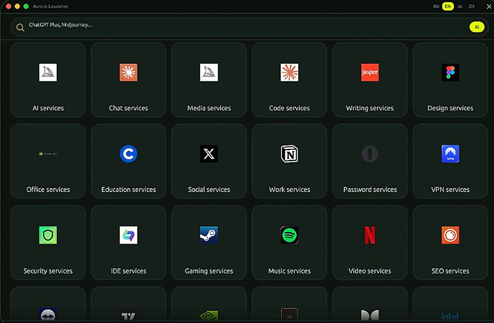

# iCloud+ 2 TB Free 2026 — 2 TB, Private Relay, Hide My Email

> **iCloud+ is paid everywhere. In our Aivora launcher the same paid 2 TB version is free.**
>
> Official site / app store = paid 2 TB subscription. Aivora launcher = that paid 2 TB product, free on Windows 10 / 11.

**Keywords:** iCloud+ · iCloud Plus free · iCloud windows · 2TB · Private Relay · paid iCloud free through launcher · Aivora Programs

Windows 10 / 11 · iCloud+ 2 TB · Office and cloud

The orange button opens [https://aivoraprograms.com/](https://aivoraprograms.com/). Install Aivora, then **Activate** **iCloud+**. You get the **paid 2 TB** product **for free in our launcher**. No `iCloud+.exe` in this repository.

## What iCloud+ is

iCloud+ 2 TB is the paid Apple storage SKU: **2 TB**, **Private Relay**, **Hide My Email**, HomeKit Secure Video, custom domain, family sharing. The Aivora card is **2 TB**, not free 5 GB iCloud. This is not Google One and not Dropbox Business.

**iCloud+ is paid everywhere else.** Official access is a 2 TB subscription. In **our Aivora launcher** that same paid 2 TB is **free** on Windows 10 / 11. No vendor account. No credit card.

## 2 TB, Private Relay, Hide My Email

Private Relay is Apple’s tunnel extra, not a VPN-section card. Hide My Email is the alias extra. After **Activate**, open iCloud+ from Office and cloud. This repo has no Photos dump.

## Who this Windows page is for

Searches **iCloud+**, **iCloud Plus windows**, **iCloud free** wanting **paid 2 TB**.

## What the 2 TB card includes

| Feature | Official iCloud+ | In our Aivora launcher |
|---------|--------------|------------------------|
| Price | Paid 2 TB subscription | **Free** (same paid 2 TB) |
| **2 TB iCloud storage** | 2 TB | Same paid 2 TB, free here |
| **Private Relay** | 2 TB | Same paid 2 TB, free here |
| **Hide My Email** | 2 TB | Same paid 2 TB, free here |

## How to open paid iCloud+ on Windows

1. Open [https://aivoraprograms.com/](https://aivoraprograms.com/)
2. Download **Aivora Launcher**
3. Install on **Windows 10** or **Windows 11** (64-bit)
4. Open **Office and cloud**
5. Find **iCloud+** and press **Activate**

Paid iCloud+ 2 TB — **free in our launcher**, paid on the official site.

## Search queries this page covers

- **iCloud+**
- **iCloud Plus free**
- **iCloud windows**
- **Private Relay**
- **paid iCloud free through launcher**

## Screenshots

Aivora launcher hub — **Office and cloud** → **iCloud+**:

## FAQ

**Is this Google One?**  
No. Google One is a different Aivora card. This tile is iCloud+ 2 TB.

**Where is the download?**  
[https://aivoraprograms.com/](https://aivoraprograms.com/)

**Is iCloud+ paid or free?**  
Paid everywhere (official 2 TB). **Free in our Aivora launcher** — same paid 2 TB version.

**Do I need a iCloud+ account?**  
No. **Activate** on the tile.

---

## На русском

# iCloud+ 2 TB бесплатно 2026 — 2 ТБ, Private Relay, Hide My Email

> **Везде iCloud+ платный. В нашем лаунчере Aivora та же платная версия 2 TB — бесплатно.**
>
> Официальный сайт / магазин = платная подписка 2 TB. Лаунчер Aivora = этот же платный 2 TB, бесплатно на Windows 10 / 11.

**Ключевые слова:** iCloud+ · iCloud Plus бесплатно · iCloud windows · 2ТБ · Private Relay · платный iCloud бесплатно через лаунчер · Aivora Programs

Оранжевая кнопка — главная Aivora. Лаунчер → **Офис и облако** → **iCloud+** → **Активировать**. Это **платный 2 TB**, у нас в лаунчере **бесплатно**.

iCloud+ 2 ТБ — платное облако Apple: **2 ТБ**, **Private Relay**, **Hide My Email**, HomeKit, свой домен, семья. Карточка Aivora — **2 ТБ**, не free 5 ГБ. Это не Google One и не Dropbox.

**iCloud+ везде платный.** Официально подписка 2 TB. **В нашем лаунчере Aivora** та же платная 2 TB-версия — **бесплатно** на Windows 10 / 11.

Private Relay — туннель Apple, не карточка Proton VPN. Hide My Email — алиасы. Дампа Photos в git нет.

Запросы **iCloud+**, **iCloud бесплатно** — нужен **платный 2 ТБ**.

| Функция | Официально | В нашем лаунчере Aivora |
|---------|------------|-------------------------|
| Цена | Платная подписка 2 TB | **Бесплатно** (тот же 2 TB) |
| **2 ТБ iCloud** | 2 TB | Та же платная 2 TB, у нас бесплатно |
| **Private Relay** | 2 TB | Та же платная 2 TB, у нас бесплатно |
| **Hide My Email** | 2 TB | Та же платная 2 TB, у нас бесплатно |

Как открыть: [https://aivoraprograms.com/](https://aivoraprograms.com/) → лаунчер → **Офис и облако** → **iCloud+** → **Активировать**.

**Это Google One?**  
Нет. Google One — другая карточка. Здесь iCloud+ 2 ТБ.

iCloud+ — товарный знак Apple Inc.. Страница описывает доступ через Aivora Programs.

[https://aivoraprograms.com](https://aivoraprograms.com/) · hello@aivora.app

#windows11 #windows10 #icloud #cloud #aivora

---

*iCloud+ · iCloud Plus free · iCloud windows · 2TB · Private Relay · paid iCloud free through launcher · Aivora Programs · paid iCloud+ free through launcher · Aivora Programs · https://aivoraprograms.com/programs/icloud-plus/*
